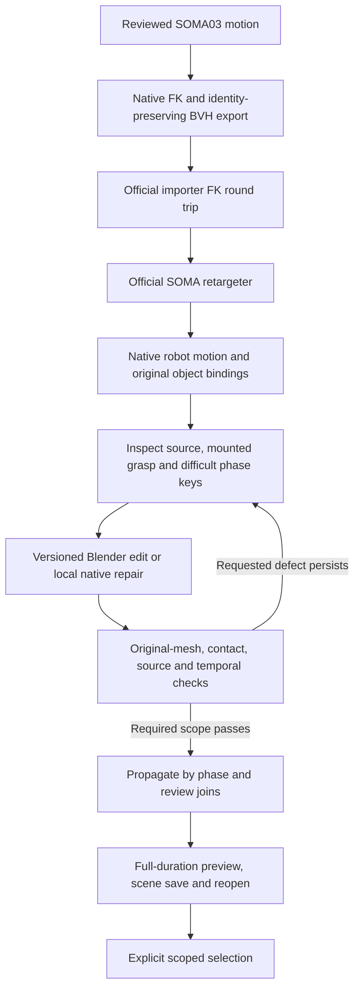

# Robot retargeting from GRAIL

GRAIL supplies the human/object handoff; the pinned
[`imports/agentic-retargeter`](../imports/agentic-retargeter) checkout supplies
robot solvers, native Blender editing, local repair, geometry audits and batch
execution. The entry point is `python -m grail.retargeting.agentic`. It routes by
the explicitly declared body model and records each subprocess, elapsed time,
input/config/code hashes and output status.

The current submodule pin is `41264543b9ba220f952f4e2088d419000e8e5b0f`
(shared hand initialization with static support geometry, CUDA forward and
synchronous SOMA optimization).
Omitting `runtime.checkout` selects the bundled tools. See the
[retargeting guide](../imports/agentic-retargeter/docs/current-retargeting-workflow.md)
for hand initialization and whole-body fitting. Check the input schemas when using another checkout.
Older runtimes may lack dense patches, coupled hold repair or the current
correction policy.

| GRAIL source | Initial conversion | Native robot output |
| --- | --- | --- |
| `soma03` | Native SOMA03 FK → verified SOMA-base BVH → official NVIDIA soma-retargeter | Bundled `unitree_g1`: 36 qpos / 29 body joints. Custom `unitree_g1_dex3`: 50 qpos / 43 joints, including 14 finger joints |

Choose the robot morphology before conversion. For manipulation, Unitree G1 solves seven joints in each hand. Preserve their native order for contact review.

## Carry the original support scene

Native SOMA handoffs retain static scene geometry. If the
HOI source contains a table, include that original table in the editable robot
scene and source/novel-view renders. Mesh vertices, topology, dimensions and
placement follow the moving object's world conversion once. Preserve table
placement unless a separately authorized correction is declared; retain original
geometry, dimensions and the unmodified source binding. Review object support
through stationary/contact phases and compare collision coverage after a change.
Permission to correct an object trajectory does not by itself authorize a table move.

The handoff packs `static_scene_json` (`grail.static_scene.v1`) and indexed
`static_scene_000_vertices` / `static_scene_000_faces` arrays into native NPZs.
Vertices are already in the native world frame in metres. Original source
hashes and transforms are recorded. The shared Blender preview loads these
meshes into `GRAIL_StaticScene` and verifies them on replay. This is scene
preservation and visualization, not a newly solved table-collision constraint.

New `indoor2-manipulation` generation explicitly selects its original baked-in
table using `support_object_names` in `configs/scenes/default.yaml`; geometry
passes through `static_objects` to the reconstruction's `scene_data`. Other
scenes only include their explicitly recorded supports. No table is inferred
from object category or height. Missing historical metadata is `UNKNOWN`;
an explicit empty scene is `EMPTY`.

For a historical result whose table was omitted, export from its verified
original scene with exact object names, preserving the original file:

The source scene must use `unit_settings.scale_length = 1`, matching GRAIL's
world-metre convention. Non-unit scene scales are rejected before export;
the helper does not infer or silently apply a coordinate conversion.

```json
{
  "scene_blend": {"path": "/assets/original_scene.blend", "sha256": "<sha256>"},
  "object_names": ["<exact original table mesh name>"],
  "output_npz": "/runs/case/original_scene.npz"
}
```

```bash
blender -b /assets/original_scene.blend --disable-autoexec --python-exit-code 1 \
  --python grail/retargeting/blender_scene_export.py -- --request scene_request.json
```

Bind that file in the existing retarget YAML:

```yaml
native:
  # For raw SOMA keep object_mesh and the existing source export settings.
  scene_sidecar: /runs/case/original_scene.npz
```

SOMA embeds this geometry in its object handoff before native conversion.
Pre-exported SOMA BVH callers should embed the scene
when creating their bound object sidecar. Legacy `.blend` files need a new saved
scene version with the scene-bearing native input; existing files are not changed.

The packed representation preserves original geometry, including Blender's
triangulation of original polygons; it does not bundle source shader networks or
textures. Native Blender refinement currently requires a supported MJCF model;
CSV-only URDF targets keep this handoff but do not gain a Blender rig automatically.



## Install and configure

The bundled retargeter is pinned in `imports/agentic-retargeter/VENDORED_REVISION`. Initialize the public runtime dependencies with `git submodule update --init imports/soma-retargeter`.

Use Python 3.11+ for the standalone tools; native conversion needs NumPy,
SciPy and MuJoCo. Use the locked official SOMA retargeter environment, and GRAIL’s SOMA-X 0.3.3 environment for native export. See the pinned [SOMA setup guide](../imports/agentic-retargeter/tools/soma_retargeter/README.md).
The bridge preserves virtual-environment Python symlinks when executing them.

For the G1 target with articulated hands, use the bundled XML and meshes in `assets/robots/unitree_g1`. The standalone SMPL-X route requires a separate legacy installation.

All options live in one case YAML; CLI flags select only an action, that YAML,
and a new receipt directory. Paths resolve relative to the YAML. Output
directories must be outside the code and source-case trees. Runtime paths below
are placeholders; no developer-specific installation is required.

For SOMA contact-aware initialization, `backend.contact_constraints` names the
standalone contact-specification JSON, relative to this YAML (or an absolute
path). Paths inside that specification remain relative to the specification
itself.

For a native SOMA03 Stage 2 fit, set `source.python` to the GRAIL interpreter that can load the reconstruction pickle and its SOMA model. In the published Docker image this is `/root/miniconda3/envs/grail/bin/python`. Use the SOMA Retargeter virtual environment for `backend.python`.

```yaml
schema_version: 1
source_model: soma03
runtime:
  python: /envs/retarget/bin/python
source:
  path: /cases/example/stage2.pkl  # or canonical native SOMA03 NPZ
  python: /envs/grail/bin/python
  ground_initial_frame: true  # default for fresh raw SOMA handoffs
  model_config:
    model_type: soma03
    backend: native
    soma_runtime: gem_x
    gem_x_soma_assets: /repos/GRAIL/imports/GEM-X/assets/soma
    soma_identity_params_path: /models/matching_identity.npz
    device: cpu
backend:
  soma_root: /repos/soma-retargeter
  python: /repos/soma-retargeter/.venv/bin/python
  robot: unitree_g1
  human_scale_ratio: 1.0  # default for robot-matched custom SOMA bodies
  device: cpu
native:
  enabled: true
  object_mesh: /cases/example/original_object.obj
  # object_scale: 1.0  # only if this explicit mesh has scale already baked in
```

The identity parameter file is optional; when supplied it must match the source
exactly. The exporter preserves each source identity and scale. It does not fit
the identity, average shape or reuse the legacy MHR-backed SOMA loader.

Fresh raw SOMA handoffs default to `source.ground_initial_frame: true`.
Before export, evaluate the original full human mesh at frame zero and compute
`delta_z = -min(vertices[0, :, 2])`. Apply the single fixed translation
`world_offset = [0, 0, delta_z]` to every human and object frame, the original
static table/support mesh (including a bound `native.scene_sidecar`), and the
camera handoff. This places the first-frame human mesh minimum at `z = 0` while
preserving human/object/table relative placement throughout the clip.

The translation preserves mesh topology, dimensions, rotations, shape and
source timing. Source files remain unchanged. The BVH manifest records the
offset and first-frame mesh measurement; `native_source.npz` contains the
translated motion. Neutral calibration transforms in `native_rest.npz` remain
unshifted. Inherited world-space geometry, camera and target caches are omitted
from the canonical motion file; use the translated scene and camera handoffs.

When `backend.bindings.camera` supplies camera JSON, the bridge writes a new
camera binding for the same world translation, preserving projection. Supported
explicit conventions are the native Blender `original_fields.cam_R/cam_t`,
`world_to_camera` with R/t, and `pytorch3d_world_to_camera` with R/T.

Build contact constraints and hand targets after this export from the translated
human/object/scene inputs. The raw-source bridge rejects previously prepared
world targets and object sidecars when grounding is enabled; use
`native.object_mesh` to regenerate the sidecar. Already exported BVH inputs are
used as-is and receive no second grounding translation. Set
`source.ground_initial_frame: false` to retain a raw source's original placement.
The lower-level `grail.retargeting.soma_export` CLI remains opt-in through
`--ground-initial-frame`.

The SOMA retargeting adapter defaults `backend.human_scale_ratio` to `1.0`
for every robot target. The custom G1, H2, T1, X2 and A3 bodies already match
their robot's height, so retargeting preserves their metric size instead of
applying the target's generic-human height ratio again. The effective ratio is
recorded in the backend configuration and conversion receipt. Set a positive,
finite numeric value explicitly in YAML when another source needs uniform
rescaling; this option applies only to SOMA. Source BVH units remain `cm`, and
the source files, robot assets and object trajectory are unchanged. Retargeting
still applies the target's joint offsets and IK mapping; a scale ratio of `1.0`
does not make the custom human skeleton identical to the mechanical skeleton.

The bundled H2 (`unitree_h2`), T1 (`booster_t1`), X2 (`agibot_x2ultra`) and A3
(`agibot-a3t3`) targets use URDF descriptions. Their official SOMA CSV route
supports the same scale policy, while native NPZ export and Blender refinement
currently require MJCF. For these URDF targets, retain the CSV and conversion
receipt with this configuration overlay:

```yaml
backend:
  # Keep soma_root, python and source settings from the SOMA example.
  robot: unitree_h2  # or booster_t1, agibot_x2ultra, agibot-a3t3
  human_scale_ratio: 1.0
native:
  enabled: false
```

```bash
python -m grail.retargeting.agentic plan --config case.yaml --output /runs/case_plan
python -m grail.retargeting.agentic run --config case.yaml --output /runs/case_initial
```

`preflight` is also available. For raw SOMA, `plan` prepares the export command;
`preflight` reports that the native export is still required. `run` performs and
verifies that export, then executes official runtime preflight and conversion.
For an already verified BVH, omit `source` and set `backend.source`,
`source_units: cm`, `source_facing_direction` and bound human-model evidence.

### A custom SOMA robot target

The SOMA route can pass an explicit `backend.extra_robot_paths` list to a
compatible Agentic Retargeter adapter. These directories resolve relative to
the case YAML, even though the generated backend JSON lives in a new execution
directory. Each directory contains an upstream robot-registry manifest and its
retarget configuration. The selected `backend.robot` must name that actual
target. A CSV for the 29-joint configuration contains no finger trajectories.

Use this route for a Unitree G1 target with articulated hands with all 43 scalar joints represented in
the SOMA solve. The original hand-capable model, its full dependency closure,
joint-name correspondence, hand reference frames, scaler and IK targets must
be bound by the adapter. Native export must contain all 50 qpos coordinates
from the actual solver output. Robot fingers remain subject to the original
limits and subsequent grasp/approach review.

```yaml
backend:
  # Keep soma_root, python, device and source settings from the SOMA example.
  robot: unitree_g1_dex3
  extra_robot_paths:
    - ./targets/g1_dex3
```

The original bundled `unitree_g1` uses 29 body joints. The current
pinned adapter supports custom registries, including `unitree_g1_dex3`, without a
standalone-checkout override. An explicitly selected older runtime must fail if
it lacks this support. Do not claim that configuring a target alone validates its hand mapping
or contact quality.

The pinned checkout provides `src/soma_target.py` to build the
`unitree_g1_dex3` registry bundle from the original G1-with-hands MJCF and a
verified `source.bvh` / `native_rest.npz` export. See its
[target generator instructions](../imports/agentic-retargeter/tools/soma_retargeter/README.md).
It retains the official body tasks and adds native SOMA thumb, index and middle
segment/tip targets to the same Newton solve. The two human long digits are
explicit representatives; ring and little fingers do not create extra robot
DOFs. Original joint limits and mirrored axes remain unchanged. For the current
already G1-proportioned SOMA sources, the generator requires a declared metric
scale of 1.0; it is not a general identity-fitting or human-rescaling tool.

## SOMA coordinate and object contract

The native export declares GRAIL's z-up metre world. It uses all 78 public
SOMA-base joints, including the virtual root. It exports FK transforms with
identity-dependent joint translations, rather than reinterpreting raw pose
axis angles as BVH Euler angles. BVH uses centimetres and the inverse of the
official `Mujoco` facing conversion (`Rx(-90°)`). The official importer then
applies `Rx(+90°)`, returning the same z-up world.

Every export is read by the official importer; all-frame joint transforms,
hierarchy and FPS must match. Formats whose FPS would change under the official
importer's two-decimal rounding fail explicitly. Source/model/importer bindings
and the maximum round-trip errors are saved in `source_export/manifest.json`.

`source_export/native_rest.npz` additionally retains the actual SOMA03 zero-pose
FK with the bound source identity and scale. `transforms` is in GRAIL's z-up
metre world; `bvh_transforms` uses the pre-facing-conversion BVH axes, also in
metres. Both include complete rotations, joint names and parents. Use this
artifact for custom hand-frame calibration: the translation-only BVH `OFFSET`
hierarchy does not preserve those neutral rotations, even though the animated
six-channel FK round trip is exact. The rest artifact is not the video's first
pose and does not modify the source animation.

The object sidecar preserves source `obj_R`, `obj_t` and `obj_scale` with the
same frame count and timestamps. It binds the original HOI, exported BVH and
original mesh hashes. Initial conversion does not infer object motion from the robot. An optional
scale override is explicit and recorded for a mesh whose scale is already baked
in. Camera and scene evidence remain separately bound inputs for refinement.
Neither BVH export nor native conversion re-estimates camera or geometry.

## Generated-HOI correction scope

For this project's generated-HOI retargeting, the user has authorized only
**small translation/rotation corrections close to the original object trajectory**.
Retain its spatial path, key orientations, motion direction, action/event timing
and table support. Preserve original human arrays, camera, geometry/scale,
object trajectory and the fresh robot conversion as immutable references.
Declare per-case caps on translation-norm and rotation-angle deviation at the
same original timestamps; there are no universal default caps. Save corrected
paths as versioned candidates, retain stationary/support intervals, and review
both hands against the same corrected path.

All rounds measure these deviations against the fixed original reference.
Changing the repair parent or seed never resets the accumulated offset budget;
event timing is preserved unless separately authorized. If body-posture,
contact and object-reference bounds cannot all be satisfied, retain a partial
result or revise the grasp instead of silently widening any bound.

Keep reference torso/pelvis posture and shoulder/elbow configuration separate
from uncertain generated finger/wrist detail. Before accepting a large torso lean
or widening body-pose tolerances to reach a grasp, test the authorized bounded
common-object adjustment. Compare source views and native body deviations as
well as material gaps, slip, collision and temporal measures. Record unavailable
source checks as unknown. Contact improvement does not imply pose fidelity.

For body-fidelity corrections, select a runtime supporting the sequence/transition
`posture_reference` and follow its `tools/grasp/README.md` schema. Bind the original
native motion/hash, an inclusive frame window and explicit named-hinge deviation
limits; no limits are supplied implicitly. Parent edit corridors and frozen
samples remain distinct from this posture target and the initial seed. The
reference's object trajectory may differ from the corrected candidate's.
Review the final `posture_reference_gate` alongside the other gates. This is a
native-posture proxy; `diagnostics.human_reference` alone supplies advisory
statistics, and neither substitutes for human-body/source-image review.

The standalone sequence solver
keeps the supplied object path fixed: prepare and bind a revised path shared by
parent and seed, keep the original posture prior, then repair the robot trajectory.
Alternating these steps does not constitute a joint robot/object solver or an
acceptance guarantee. A new object path invalidates dependent contact, collision,
support and render evidence even if robot joint values are unchanged.

When an upstream HOI contact map is available, reuse its bound object-side regions
and phase evidence. Verify source/timing, original object topology, scale and
coordinate conventions; human vertex IDs cannot be copied onto robot geometry.
Pool the four human long-finger object regions without double-counting overlap,
then declare the individual robot fingers and normalized dense material patches
using the current standalone grasp tools. Distinguish eligible contact regions,
exported material pairs and measured proximity. Authored hypotheses are not
neural predictions; insufficient member coverage remains a shortfall. Preserve
declared sliding/support phases instead of imposing one fixed grip universally.
Keep normal alignment diagnostic with `normal_weight: 0` unless explicitly
requested; dense contact reuse does not add an implicit normal acceptance gate.

Record the edit bounds, body references and tolerances, contact targets and
initialization policy in the case plan.
An explicit from-scratch request regenerates source export, robot conversion and
robot contact candidates from the requested human reconstruction and HOI priors;
previous robot trajectories, wrist/finger poses and robot anchors are comparison
evidence only. Preserve the existing case clock across these decisions. These are
case-policy requirements, not additional executable adapter YAML fields.

## Review and handoff

Inspect the grasp, support contacts, clearance against the original mesh and continuity across frames. Save a new native candidate and reopen its scene before selection. Use the [handoff command](source/retargeting.md) to package a reviewed result.
