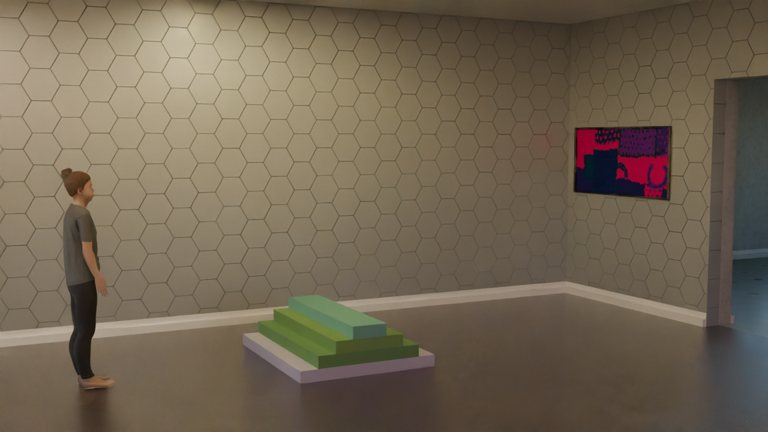

# 2D HOI Generation

<span id="generate-a-video-and-its-scene-inputs"></span>

Robot-centric human video generation starts from a known scene, camera and character. The two released examples, stairs and kettlebell, start with generated video and registered scene inputs. This guide reproduces a stair conditioning frame and shows how to inspect a provider result. A complete new-object example from mesh to reviewed fit and robot motion is still missing.


<span id="required-environment"></span>
## Configs

<span id="choose-a-scene-preset"></span>

| Scene | Pipeline YAML under `configs/gen_2dhoi/` |
|---|---|
| Table or ground pick-up | `pickup_table.yaml`, `pickup_ground.yaml` |
| Moving-object manipulation | `manipulation.yaml` |
| Sitting | `sitting.yaml` |
| Traversing curbs, slopes or stairs | `terrain_curbs.yaml`, `terrain_slope.yaml`, `terrain_stairs.yaml` |

Check the object list and room settings in your copy before rendering. To scale a character mesh, the renderer accepts `--character_scale X Y Z` with three positive finite factors. Preserve the resulting scale and scene calibration through fitting.

## Quickstart

<span id="render-one-conditioning-frame"></span>

Start in the checkout root of the release container, in the `grail` environment. You need the [four-step staircase](gen_3d_assets.md), `data/Scene/indoor1.blend`, the bundled character USD and textures, and the installed `imports/blender/blender`. The run directory is the writable mount from [GRAIL Installation Guide](installation.md). If these assets are missing, get the {blob}`released room <data/Scene/indoor1.blend>` and the complete {src}`character folder <data/body_profiles/unitree_g1/characters/dhgen_00008>` with its textures before rendering.

For this stair scene the room is 331.4 MiB. Floor pickup uses {blob}`indoor2.blend <data/Scene/indoor2.blend>` (241.7 MiB). Table pickup uses {blob}`indoor2_notable.blend <data/Scene/indoor2_notable.blend>` (26.8 MiB) and `data/Scene/long_table.obj` (2.5 MiB) with its material. In your pickup YAML copy set `scene_config: configs/scenes/default.yaml`: the shipped rules for both pickup rooms are in that file. The character USD is 5.8 MiB; fetch the whole 55.9 MiB folder so its textures resolve. Check that the files are hydrated before opening Blender. Use the [floor or table pickup presets](configuration.md#configuration-by-motion-type) and your own object list for a moving object.

Create the guide output directory, then select the shipped stair object list and use the procedural mesh at its native scale. This renders one seed at 1280 × 720 on the CPU. The case reads the starting pose from the scene configuration.

```bash
mkdir -p /workspace/runs/guides
python - <<'PY'
from pathlib import Path
import yaml
cfg = yaml.safe_load(Path("configs/gen_2dhoi/terrain_stairs.yaml").read_text())
cfg["object_config"] = "configs/objects/terrain_syn_stairs.yaml"
cfg["simulation"]["use_initial_state"] = False
cfg["rendering"].update(samples=4, gpu=False)
Path("/workspace/runs/guides/one-stair.yaml").write_text(yaml.safe_dump(cfg))
PY
python -m grail.pipelines.gen_2dhoi --config /workspace/runs/guides/one-stair.yaml \
  --dataset guide_terrain --category stairs_000 --num_rand_scenes 1 \
  --character_usd data/body_profiles/unitree_g1/characters/dhgen_00008/*.usd \
  --results_dir results/one-stair --skip_step4
```

Under `results/one-stair/generation/`, follow `guide_terrain/stairs_000/` in each output directory. For the same seed you should find:

| Directory | What to inspect |
|---|---|
| `asset_renders/`, `cameras/` | The color PNG shows the character and steps from the chosen camera. There is one matching camera pickle. |
| `foundation_pose/` | Open the object's first mask. Check it isolates the stairs. Keep `cam_K.txt` and `first_frame_pose.pickle` with this seed. |
| `depth_maps/`, `mesh/` | Reconstruction reads `000000.png`, one-channel uint16 depth in millimetres. The render also produces float EXR depth in metres. Keep the original metric OBJ and materials. |

The command shown took 17 seconds on an i9-14900K in `nvgrail/grail:1.2.0`. Rendering used four samples, one frame and no GPU. If loading the stairs preset fails before rendering, verify that the **pipeline YAML itself** selects `configs/objects/terrain_syn_stairs.yaml` as above. If Blender cannot load the character, check the actual USD and its relative texture directory.



The room preset controls the output dimensions. The verified PNG and both masks are 1280 × 720. Keep the source dimensions with the camera intrinsics.

## Conditioning frame checks

<span id="check-the-conditioning-frame-before-requesting-a-video"></span>

The original procedural terrain has 24 polygon faces. Pass `--static-terrain` to retain them. Moving-object contact maps require an ordered triangular OBJ. `--conditioning-only` reads the rendered PNG in place of a video. It still checks both masks, camera, original mesh and registered depth.

In the `grail` shell set `GEN=results/one-stair/generation` and `SCENE=unitree_g1_dhgen_00008_indoor1-syn-stairs_rand00001`. If the renderer left only `0000000001.exr`, convert that frame to millimetres first. The helper refuses to overwrite existing depth.

```bash
GEN=${GEN:-results/one-stair/generation}
SCENE=unitree_g1_dhgen_00008_indoor1-syn-stairs_rand00001
DEPTH="$GEN/depth_maps/guide_terrain/stairs_000/$SCENE"
# Only for an EXR-only render:
if [ ! -f "$DEPTH/000000.png" ]; then
  OPENCV_IO_ENABLE_OPENEXR=1 python scripts/standalone/convert_frame_depth.py "$DEPTH/0000000001.exr" "$DEPTH/000000.png"
fi
export PYTHONPATH="$PWD/imports/SONIC:$PWD${PYTHONPATH:+:$PYTHONPATH}"
python scripts/standalone/check_capture.py "$GEN" "guide_terrain/stairs_000/$SCENE" \
  /workspace/runs/guides/stair-frame.jpg --static-terrain --conditioning-only
```

The released container on the i9 checked 875,220 usable background pixels in this render. Open the overlay and verify that the projected staircase follows the visible edges. If EXR decoding fails, keep the original and use the release container's OpenCV in the `grail` environment.


<span id="common-variants"></span>

## Pipeline steps

<span id="from-the-frame-to-a-video"></span>

For a single reviewed seed, reuse the render's exact config, dataset, category, seed count and results directory. In the generation CLI's arguments, **replace** `--skip_step4` with `--skip_step1 --skip_step2 --skip_step3 --no-skip_step4`. This selects the provider stage without simulating or rendering again. Review which input renders it will find in that directory. Set `KLING_ACCESS_KEY` and `KLING_SECRET_KEY`. Set `OPENAI_API_KEY` if `video.skip_prompt_refinement` is false, or set that field to true and supply the prompt yourself. Provider submission, cost and latency were not tested here.

For pickup with start and end frames, the returned MP4 stem can end in `_start00001-end00001`. The conditioning camera, masks and depth use the start-frame stem, ending in `_start00001`. In the checker pass `dataset/category/<full MP4 stem>` as the sequence and `--scene-id <start-frame stem>` as a separate argument. To check the returned clip's duration and rate, pass **its exact path** to `ffprobe` with the options below. For example, in the repackaged pickup check:

```bash
GEN=/workspace/runs/my-lift/generation
SEQ=Lab/weight/lift01-start-end
ffprobe -v error -select_streams v:0 -count_frames \
  -show_entries stream=width,height,avg_frame_rate,nb_read_frames -of csv=p=0 "$GEN/videos_kling/$SEQ.mp4"
```

Here `lift01-start-end` selects the returned video. Pass `--scene-id lift01` when checking it against the starting frame. The two bundled videos can also be probed together:

```bash
for case in stairs kettlebell; do
  ffprobe -v error -select_streams v:0 -count_frames \
    -show_entries stream=width,height,avg_frame_rate,nb_read_frames -of csv=p=0 \
    examples/g1-2dhoi/"$case"/generation/videos_kling/*/*/*.mp4
done
```

In the standard image the two probes together took about one second. The lines for stairs and kettlebell should report **1280 × 720, 24 fps, 241 and 121 frames** respectively. Before reconstruction, watch the whole clip. Check the camera stays fixed, the object matches its mesh and the interaction is visible. A changed object or unusable camera breaks the geometric assumptions downstream. See [prepare a new scene](tutorials/own-video.md).

<span id="runtime-boundary"></span>
<span id="setup-and-autostart"></span>
<span id="standalone-or-remote-service"></span>

## MiniMax-H3 provider

MiniMax-H3 uses a separate service and the alternative image. Use the standard image and bundled videos for the released examples. The local conditioning run above exercises Blender; it does not validate a MiniMax-H3 service. Provider options live in the {blob}`generation entry point <grail/pipelines/gen_2dhoi.py>`.


<span id="container-and-scheduler-use"></span>

## Sharded fan-out

<span id="running-independent-seeds"></span>

By default the CLI splits categories across workers. With one category, worker 0 gets every seed. To divide its seeds, pass `--no-split_by_category`, set the same `--num_job_chunks` on every worker and give each one a different zero-based `--job_chunk_idx`. Keep the seed range and configuration identical. For your first scene, inspect one local seed before expanding the batch.

## Object collections

<span id="run-the-generator-on-an-object-collection"></span>

The four stages settle the object using physics, optionally estimate its scale, render the camera and masks in Blender, and generate the interaction video. Settle and scale caches belong to the same asset and geometry. To reuse both, pass `--skip_step1 --skip_step2`. To inspect only the conditioning render, also pass `--skip_step4`. Save the original camera, metric pose, masks and depth with the rendered frame. See [configuration](configuration.md) for pickup, terrain and sitting presets.

For a prepared ComAsset case in the configured environment, the following invokes the video provider. Select a category you have downloaded and inspect the conditioning frame before this step. Provider requests can incur charges. The arguments were checked without making a video request.

```bash
python -m grail.pipelines.gen_2dhoi --dataset ComAsset --category cordless_drill \
  --config configs/gen_2dhoi/manipulation.yaml --results_dir results --video_model_api kling-ai
```

For a resident or remote H3 backend, see the [service setup, modes, checkpoint mount and retry rules](minimax_service.md).

```{toctree}
:hidden:

minimax_service
```

The normal generation output separates stable poses in `generation/initial_states/`, conditioning images in `generation/asset_renders/`, cameras and depth in `generation/cameras/` and `generation/depth_maps/`, and the returned MP4 in the selected video directory. Supply your character USD, identifier and authored scale when overriding the preset. Match the original render when restarting from a cached stage. See the [scene-input checklist](tutorials/own-video.md) before using the clip for reconstruction.
