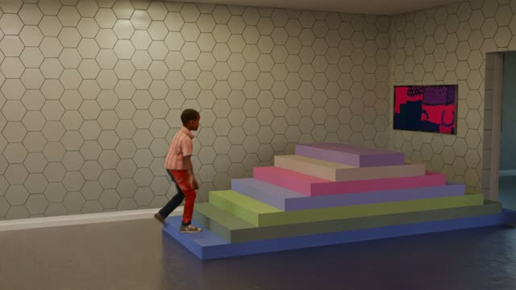
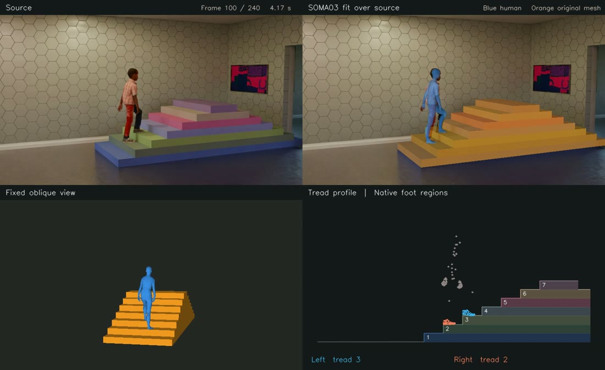
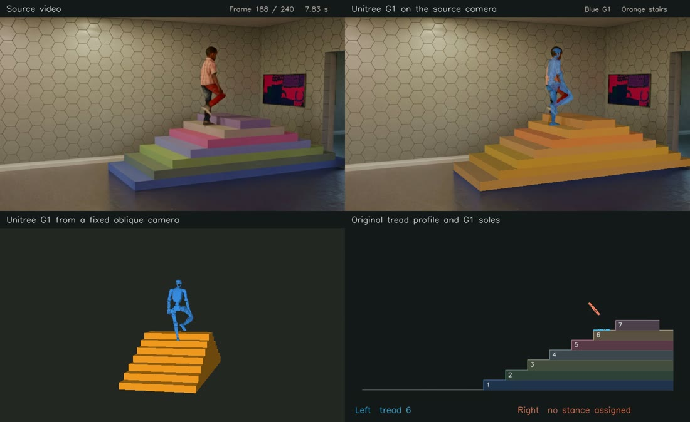
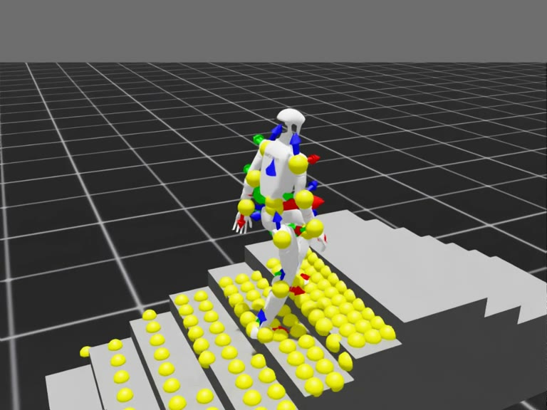
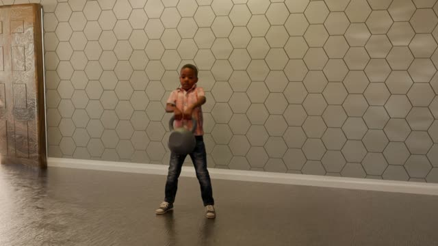
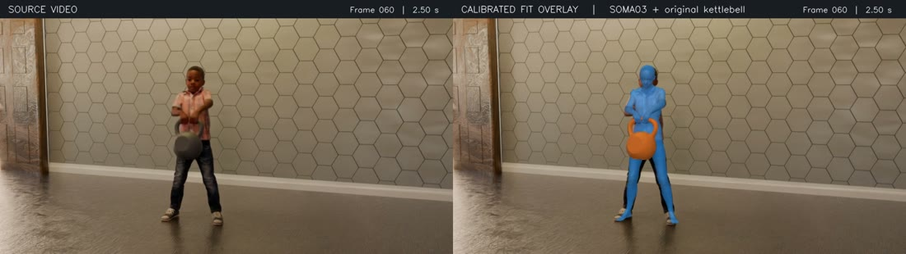
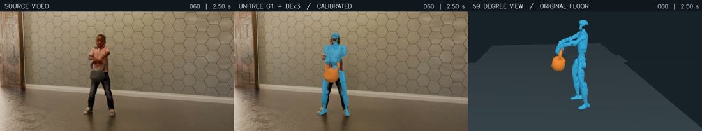
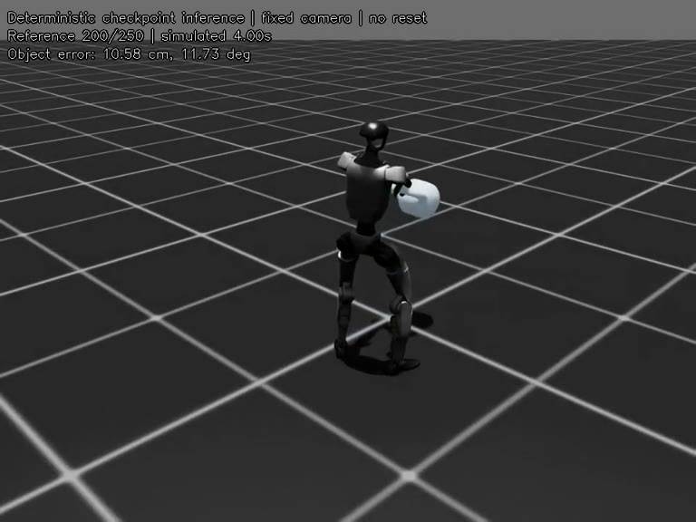

# Example Results

Follow each case from the source video to simulated motion. Select a stage to see its files, measurements and runtime. The source column plays the bundled input. The human and G1 columns come from the tutorial in `nvgrail/grail:1.2.0` on one 48 GB RTX 6000 Ada. The tracking column comes from a 5,000-update run in production image `nvgrail/grail:1.1.0` on one L40S. Its human fit and robot trajectory were generated independently.

## Stair climb

<video controls playsinline preload="none" poster="_static/examples/stairs.jpg" aria-label="Person approaching the white staircase"><source src="_static/examples/stairs-input.mp4" type="video/mp4"></video><a href="tutorials/stairs.html#before-you-start">Source video</a>

<video controls playsinline preload="none" poster="_static/examples/stairs-recon.jpg" aria-label="A stair climb shown in the original video, the fitted camera view, a fixed oblique view and a tread profile."><source src="_static/examples/stairs-recon.mp4" type="video/mp4"></video><a href="tutorials/stairs.html#stairs-recon-result">Human reconstruction</a>

<video class="grail-stage-player" controls playsinline preload="none" poster="_static/examples/stairs-robot.jpg" aria-label="Whole G1 climbing with its left foot on the sixth tread, beside the source frame, fixed oblique view and sole profile."><source src="_static/examples/stairs-robot.mp4" type="video/mp4"></video><a href="tutorials/stairs.html#stairs-robot-result">G1 retargeting</a>

<video class="grail-stage-player" controls playsinline preload="none" poster="_static/examples/stairs-tracking.jpg" aria-label="Simulated G1 ascending the staircase at update 5,000"><source src="_static/examples/stairs-policy-diagnostic.mp4" type="video/mp4"></video><a href="tutorials/stairs.html#stairs-track-result">Tracked rollout</a>

The stair rollout is from a second evaluation of the 5,000-update stair policy. The following camera records the complete rollout: one L40S, driver 580.95.05, `nvgrail/grail:1.1.0`, one environment, 500 frames at 50 fps. The [recorder command](tracking.md#stair-policy-rollout) runs separately from the trainer's checkpoint metrics.

Watch the 10-second stair policy recording

<video controls playsinline preload="none" poster="_static/examples/stairs-tracking.jpg" aria-label="Stair policy at update 5,000, following camera"><source src="_static/examples/stairs-policy-diagnostic.mp4" type="video/mp4"></video>

## Kettlebell lift

<video controls playsinline preload="none" poster="_static/examples/kettlebell.jpg" aria-label="Person reaching for the kettlebell"><source src="_static/examples/kettlebell-input.mp4" type="video/mp4"></video><a href="tutorials/kettlebell.html#before-you-start">Source video</a>

<video class="grail-stage-player" controls playsinline preload="none" poster="_static/examples/kettlebell-recon.jpg" aria-label="Full original video frame and calibrated SOMA overlay of the lifted kettlebell during the first swing."><source src="_static/examples/kettlebell-recon.mp4" type="video/mp4"></video><a href="tutorials/kettlebell.html#kettlebell-recon-result">Human reconstruction</a>

<video class="grail-stage-player" controls playsinline preload="none" poster="_static/examples/kettlebell-robot.jpg" aria-label="The source, calibrated robot overlay and oblique G1 view show the lifted kettlebell at frame 60."><source src="_static/examples/kettlebell-robot.mp4" type="video/mp4"></video><a href="tutorials/kettlebell.html#kettlebell-robot-result">G1 retargeting</a>

<video controls playsinline preload="none" poster="_static/examples/kettlebell-tracking.jpg" aria-label="Simulated G1 holding the lifted kettlebell at update 5,000"><source src="_static/examples/kettlebell-tracking.mp4" type="video/mp4"></video><a href="tutorials/kettlebell.html#kettlebell-track-result">Tracked rollout</a>

Both tracking packs record `object_mass_kg: 0.1`, and the production evaluator logged a mass of 0.100 kg after applying the physics override. The fixed-camera rollout shows the simulated object rising 0.74 m from its initial height. The final evaluation recorded all 250 physics steps.

## Full-schedule checkpoint results

One evaluation per checkpoint and example on an L40S, with 2,048 environments, 5,000 PPO updates and an evaluation every 1,000. The production run used `nvgrail/grail:1.1.0`. Read completion as the fraction of the *one input reference* reached. Global joint error is the mean Euclidean distance between simulated and reference joints. Kettlebell error is the mean distance between simulated and reference object centres.

| PPO update | Stairs completion | Global joint error | Kettlebell completion | Object position error |
|---:|---:|---:|---:|---:|
| 1,000 | 100% | 62.0 mm | 100% | 9.6 cm |
| 2,000 | 100% | 90.1 mm | 100% | 6.6 cm |
| 3,000 | 100% | 54.6 mm | 100% | 4.8 cm |
| 4,000 | 100% | 76.9 mm | 100% | 6.8 cm |
| 5,000 | 100% | 43.6 mm | 100% | 6.1 cm |

The full training workflows took about 4 h 13 min for stairs and 8 h 45 min for kettlebell. The first four kettlebell checkpoints were evaluated separately after training. Each evaluation used the saved policy for that update. The kettlebell clip comes from the final evaluation. The stair recording and reported errors come from distinct rollouts of the same final policy.

The [stairs](tutorials/stairs.md) and [kettlebell](tutorials/kettlebell.md) tutorials report their short release-image evaluations separately. On an RTX 6000 Ada with driver 595.99.02, the documented kettlebell smoke test uses metrics-only evaluation.

## Release-image run details

The prompts request named delivery files. Extra review and measurement filenames below are from the recorded runs and may differ in a fresh fit.

(stairs-recon-details)=
### Stairs · human reconstruction

32 min 52 s on an RTX 6000 Ada (48 GB) in `nvgrail/grail:1.2.0`, including review and preview creation. The comparison contains 241 frames at 24 fps.

This fit used 400 iterations. Across 536 labelled heel/toe frame samples the absolute sole-to-tread distance was **0.4 mm median** and **3.6 mm at the 95th percentile**. No labelled sample hovered more than 20 mm or penetrated its support plane by more than 10 mm. At 2,989 high-confidence keypoints, median image reprojection error was 8.2 px. These contact measurements apply only to the labelled stance intervals. The run selected the fit with unresolved contacts. Elsewhere in the clip, part of the right heel overhangs tread 4 by up to 31 mm (frame 128) and lifts up to 12 mm near release on tread 5 (frame 181). The far toe is occluded at the start and end. See the per-tread review before using the fit as a contact reference.

| File | Observed size |
|---|---:|
| `reconstruction.mp4` | 1.63 MB |
| `selected_fit.pkl` | 1.55 MB |
| `selected_fit_geometry.npz` | 11.18 MB |
| `support/scene_support.json` | 47.9 kB |
| `fit_default/tread_metrics.json` | 63.0 kB |
| `review.json` | 3.2 kB |

(stairs-robot-details)=
### Stairs · G1 retargeting

8 min 43 s on an RTX 6000 Ada (48 GB) in `nvgrail/grail:1.2.0`, including review and preview creation. The comparison contains 241 frames at 24 fps.

The selected native stair motion contains **241 × 36** finite pose values at 24 fps. The original stair mesh was preserved. Over 536 labelled stance samples, median absolute in-patch sole error was **1.79 mm** (95th percentile **8.55 mm**). The review retained unresolved contacts: 33 samples had no in-patch sole point within 5 mm, the right heel overhung tread 4 by up to 66 mm, and the right toe intersected tread 5 by up to 12.6 mm. The example shows the motion selected for simulation; these measurements do not establish continuous clearance or physical load bearing.

| File | Observed size |
|---|---:|
| `robot.npz` | 97.4 kB |
| `retargeting.mp4` | 1.67 MB |
| `retargeting_review.json` | 7.6 kB |
| `retarget_work/bounded_stance_contact_audit.json` | 371.5 kB |

(stairs-track-details)=
### Stairs · short tracking run

The 64-environment command took 1 min 09 s on one RTX 6000 Ada in `nvgrail/grail:1.2.0`. The full production training workflow took about 4 h 13 min on one L40S. The production reference used an independently fitted motion from the same input video.

`tracking/train/model_step_000004.pt` (about 388.1 MB) and `tracking/eval/step_000004/metrics_eval.json` (about 7.2 kB).

(kettlebell-recon-details)=
### Kettlebell · human reconstruction

17 min 07 s on an RTX 6000 Ada (48 GB) in `nvgrail/grail:1.2.0`, including review and preview creation. The comparison contains 121 frames at 24 fps.

The selected 200-iteration Stage 2 fit is **partial**. The centre of the original CAD vertices rose **0.60 m** by frame 60 and **0.68 m** at its peak relative to frame 0, measured along the scene floor normal. During the continued grip, the median regional gap fell from 101.2 to 7.3 mm on the right and from 107.5 to 7.2 mm on the left. Both meshes still cross the handle at sampled grip frames. The second swing’s orientation and the occluded finger surfaces remain uncertain. On this shared GPU the default object-tracking window ran out of memory; the agent reran that worker with a 40-target window and recovered all 121 poses.

| File | Observed size |
|---|---:|
| `reconstruction.mp4` | 1.52 MB |
| `selected_fit.pkl` | 808.5 kB |
| `selected_fit_geometry.npz` | 9.60 MB |
| `contact_map.json` | 47.8 kB |
| `review.md` | 5.3 kB |
| `evidence/stage2_metrics.json` | 44.1 kB |

(kettlebell-robot-details)=
### Kettlebell · G1 retargeting

13 min 56 s on an RTX 6000 Ada (48 GB) in `nvgrail/grail:1.2.0`, including review and preview creation. The comparison contains 121 frames at 24 fps.

The review selected a **partial** motion with **121 × 50** finite pose values at 24 fps, including 14 finger joints. Peak wrist displacement from its mean position relative to the held object was **4.5 mm left** and **5.1 mm right**. The original mesh audit found robot–object intersections in 89/121 frames and cross-hand overlap in 11/121 frames. These are intersection counts; penetration depth and physical grasp stability require separate evidence. The native solver archive retains its unreviewed metadata; the selection and caveats are in `retargeting_review.md`.

| File | Observed size |
|---|---:|
| `robot.npz` | 64.4 kB |
| `retargeting.mp4` | 1.28 MB |
| `retargeting_review.md` | 7.0 kB |
| `retarget/synchronous_audit.json` | 336.7 kB |
| `retarget/delivery_verification.json` | 1.3 kB |

(kettlebell-track-details)=
### Kettlebell · short tracking run

The 64-environment command took 2 min 20 s on one RTX 6000 Ada in `nvgrail/grail:1.2.0`. The full production training workflow took about 8 h 45 min on one L40S. Two earlier short runs ran out of shared GPU memory during PhysX startup, before the first checkpoint. The measured time is for the completed run. The production reference used an independently fitted motion from the same input video.

`tracking/finetune/train/model_step_000004.pt` (about 16.9 MB) and `tracking/eval_final/kettlebell/summary.json` (about 0.6 kB).
