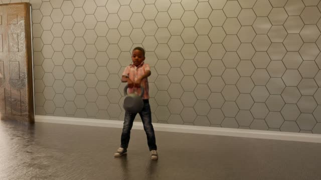
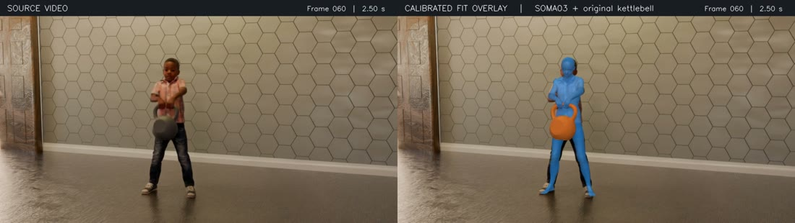
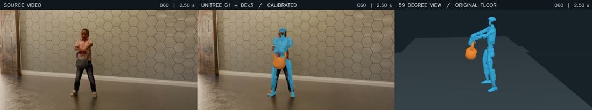

# Kettlebell Lifting with Unitree G1

<span id="lift-a-kettlebell-with-g1-and-articulated-hands"></span>

<span id="lift-a-kettlebell-with-g1-and-dex3-hands"></span>

Reconstruct a person lifting the supplied kettlebell, transfer the grasp to a robot with articulated fingers, then evaluate whether an object-aware manipulation policy keeps the object on its reference trajectory.



## Prerequisites

<span id="before-you-start"></span>

Complete [GRAIL Installation Guide](../installation.md) and [Downloads](../downloads.md). Keep the named container open. Start with `/workspace/runs/kettlebell` unused; the first prompt creates it. The same directory on the host is `../grail-demo/runs/kettlebell`. See the [glossary](../configuration.md) for terms used below.

**If an agent step stops or you reject its result**, keep the partial output and pick a fresh name such as `kettlebell-2`. For a clean repeat, change the run directory in **three places**: the reconstruction prompt, the retargeting prompt and the tracking block’s `CASE=` assignment. Keep the original example input path and motion key. Tell the agent which frame failed, what you saw and which scene or contact binding to correct. If only retargeting failed, leave the reviewed fit where it is. Change only the output directory in the retargeting prompt and set `CASE` to that directory in the tracking step.

With the model weights cached, budget about 15–20 minutes for a repeat fit and 10–15 minutes for G1 on the 48 GB RTX 6000 Ada. These are planning estimates from comparable runs. Review time and available GPU memory can extend them.

(kettlebell-fit-step)=
## 1. HOI reconstruction

<span id="reconstruct-the-human-and-object"></span>

**Host terminal, from the checkout root.** The Codex CLI reads the repository skill and runs the fitting tools in the GPU container. Use the original object geometry and review the hand and handle before, during and after contact. The fit and review took 17 min 07 s on a 48 GB RTX 6000 Ada with the depth weights cached.

```bash
codex exec --approve-for-me -m gpt-6.2-sol \
  "Use the grail-agentic-hoi-recon skill in the grail-demo container. Copy
examples/g1-2dhoi/kettlebell/generation to /workspace/runs/kettlebell/generation.
Run the released reconstruction using the installed workers. Review the hand and
handle in the source video. Save its source-frame contact map as
contact_map.json. Save the selected fit, its review and a source/fit comparison
reconstruction.mp4 under /workspace/runs/kettlebell. Run all tools in the
container using only this checkout, its downloads and this case. Report any
unresolved fit or contact."
```

(kettlebell-recon-result)=
### Expected result

<figure>

<figcaption>Frame 60, during the first swing. The source and calibrated overlay show the full body and the lifted bell from the same camera. The still documents the lift; the precise finger contacts remain unresolved. Standard release image 1.2.0, RTX 6000 Ada.</figcaption>
</figure>

Open `reconstruction.mp4` and `contact_map.json`. Watch the hands close before the bell lifts at frame 42, then compare the handle angle in the second swing at frames 94–96.

**Continue to G1** if `reconstruction.mp4` plays all 121 frames, the fitted bell follows the lift in the source view, and the grip and release intervals in `contact_map.json` match the video. Check the map against the original clip and mesh.

**Stop** if the handle sits on the wrong side of a hand, the lift starts out of phase, or the fit changes the object binding. The reference fit is partial: the hand meshes cross the handle and the second swing’s orientation is uncertain. Review those frames before treating the fit as a grasp reference.

{ref}`Run measurements and file sizes <kettlebell-recon-details>`.

(kettlebell-retarget-step)=
## 2. G1 retargeting

<span id="retarget-the-reviewed-fit-to-g1"></span>

**Same host terminal.** This converts the selected human and object motion to the 43-joint G1 with articulated hands. Conversion and review took 13 min 56 s on the same workstation.

```bash
codex exec --approve-for-me -m gpt-6.2-sol \
  "Use the grail-agentic-retargeting skill in the grail-demo container on the
selected fit in /workspace/runs/kettlebell. Retarget to Unitree G1 with seven finger joints per hand
for manipulation. Keep the original object mesh and scene binding. For source_python use the
grail environment and for the robot solver use imports/soma-retargeter/.venv.
Save robot.npz, retargeting.mp4 and the review under /workspace/runs/kettlebell.
Run all tools in the container using only this checkout, its downloads and this
case. Report any unresolved contact."
```

(kettlebell-robot-result)=
### Expected result

<figure>

<figcaption>Frame 60, first swing. The calibrated view preserves the original framing; the oblique view shows both hands and the floor. The lowest point of the bell is 0.57 m above the registered floor. Standard release image 1.2.0, RTX 6000 Ada.</figcaption>
</figure>

Open `robot.npz` and `retargeting.mp4`. Compare the two wrists, opposing fingers and moving handle in the source and oblique views.

**Continue to an exploratory simulation** if `robot.npz` has a `qpos` array of shape `(121, 50)`, `retargeting.mp4` plays all 121 frames, and the fingers follow the moving handle during the hold in both views. Run this shape check in the container’s `grail` environment.

```bash
python -c "import numpy as np; print(np.load('/workspace/runs/kettlebell/robot.npz')['qpos'].shape)"
```

**Stop before full training** if the shape differs, the grasp misses the handle, or the fingers slide or pass through it. If your review reports mesh intersections, inspect those frames. The reference had intersections in 89 of 121 frames, so the short simulation only demonstrates the workflow.

{ref}`Run measurements and file sizes <kettlebell-robot-details>`.

(kettlebell-tracking-step)=
## 3. Task-general tracking

<span id="train-and-evaluate-a-tracking-policy"></span>

**Container shell, from `/workspace/grail`.** Build the handoff from the original robot motion and reviewed contact map. The launcher packs the handoff, loads the manipulation actor warm-start actor and frozen decoder, and evaluates without the RTX video renderer. Use the licence settings reviewed in [Tracking weights](../downloads.md#tracking-weights). The short run below uses 64 environments and four PPO updates, saves a checkpoint, and evaluates it. This took 2 min 20 s on the RTX 6000 Ada, including simulator startup.

If you retried only retargeting, use the new `CASE` for the robot and handoff. In the handoff command below, pass the map from the reviewed fit, for example `--contact-map /workspace/runs/kettlebell/contact_map.json`.

```bash
source /root/miniconda3/etc/profile.d/conda.sh
conda activate sonic
export PYTHONPATH="$PWD/imports/SONIC:$PWD${PYTHONPATH:+:$PYTHONPATH}"
export OMNI_KIT_ACCEPT_EULA=Yes WANDB_MODE=disabled
CASE=/workspace/runs/kettlebell
python -m grail.retargeting.manipulation.handoff --native "$CASE/robot.npz" --contact-map "$CASE/contact_map.json" --support native --motion-key kettlebell --output "$CASE/handoff"
EVAL_NO_VIDEO=1 NUM_ENVS=64 ITERATIONS=4 EVAL_EVERY=4 bash scripts/tracking/manipulation_finetune.sh "$CASE/tracking" "$CASE/handoff"
```

(kettlebell-track-result)=
### Expected result

**Local short run:** the four-update policy reached 44.4% of the reference and ended with `failure:object_pos_deviation`. Mean object-position error was 3.1 cm over that partial lift; maximum error was 26.4 cm. The metrics-only command writes a checkpoint and JSON.

Open `tracking/eval_final/kettlebell/summary.json` under the case directory. On the host this is `../grail-demo/runs/kettlebell/`; in the container it is `/workspace/runs/kettlebell/`. Look for `tracking_success=false`, `reference_coverage=0.444` and `end_reason`. Within `object_metrics`, `object_position_error_mean_m` and `object_position_error_max_m` are in metres. The checkpoint is `tracking/finetune/train/model_step_000004.pt`.

**Payload:** the command packs a **0.1 kg** object. Check `object_mass_kg` in `tracking/pack/tracking_pack.json`. The [full L40S reference](../results.md#kettlebell-lift) used the same 0.1 kg. For a measured payload, the standalone packer `grail.retargeting.manipulation.pack` accepts `--mass-kg`; training and evaluation must consume that pack’s physics overrides. The Quick Start launcher always builds its own pack and exposes no mass override.

If the grasp already looks wrong before simulation, revisit the source and robot reviews. If simulation ran out of memory after handoff, use the {ref}`launcher-only retry <retry-manipulation>`. For full training, reuse `handoff/`, choose a new output directory and omit the short-schedule overrides. On a compatible renderer, omitting `EVAL_NO_VIDEO=1` also writes `output/eval.mp4` beside the final summary.

{ref}`Run measurements and file sizes <kettlebell-track-details>`.
