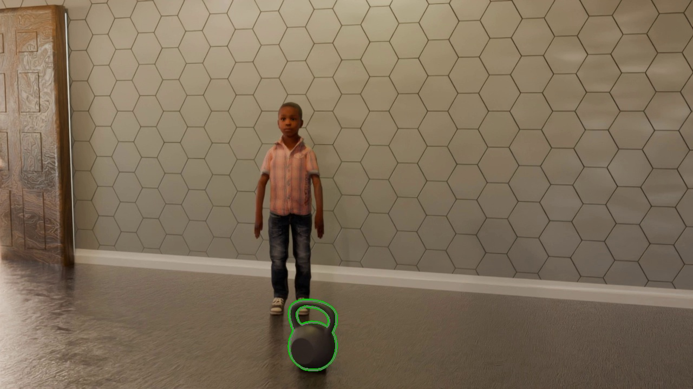

# Prepare a new scene and video

**Verification scope: this page was checked only with the released kettlebell inputs, including a copy repackaged under new names.** The two walkthroughs begin after video generation. For a new case, GRAIL’s documented route starts with an authored 3D scene and a generated video. See the [glossary](../configuration.md) for body, camera and contact terminology.

## Start with a scene you control

1. Select or [create an object mesh](../gen_3d_assets.md). Establish its physical dimensions and export a **triangulated OBJ before recording contacts**. Keep those exact mesh bytes for reconstruction, retargeting and tracking; the handoff binds contacts to the original face and vertex order.
2. Use [2D HOI generation](../gen_2dhoi.md) to place the character and object, settle the object, and render the scene in Blender. This yields the camera, object scale and initial pose, masks and metric depth in the same coordinate frame. An image-to-video model generates the RGB motion from the scene render. The released examples include these outputs.
3. Inspect the generated video against frame zero. Reconstruction estimates the moving human and object poses, tracks masks and estimates later depth. Its contact and support review still uses the actual video. If the generator changed which way the handle faces, correct or replace the case before passing it to G1.

## Inspect a fully named case

The released input root is `examples/g1-2dhoi/kettlebell/generation/`. Its sequence is `ComAsset/kettle_bell/g1_kettlebell`. These paths are relative to that root.

```text
videos_kling/ComAsset/kettle_bell/g1_kettlebell.mp4
asset_renders/ComAsset/kettle_bell/g1_kettlebell.png
mesh/ComAsset/kettle_bell/model.obj
mesh/ComAsset/kettle_bell/texture.mtl
mesh/ComAsset/kettle_bell/texture.png
cameras/ComAsset/kettle_bell/g1_kettlebell.pickle
foundation_pose/ComAsset/kettle_bell/g1_kettlebell/cam_K.txt
foundation_pose/ComAsset/kettle_bell/g1_kettlebell/first_frame_pose.pickle
foundation_pose/ComAsset/kettle_bell/g1_kettlebell/masks/000000.png
foundation_pose/ComAsset/kettle_bell/g1_kettlebell/human_masks/000000.png
depth_maps/ComAsset/kettle_bell/g1_kettlebell/000000.png
```

**GPU container, from the checkout root.** This CPU check takes a few seconds. It prints the resolved video and OBJ, checks the fitter’s frame-zero camera convention, counts original triangular faces and usable background depth pixels, and overlays projected CAD (magenta) on the object mask (green). Use camera pickles you created or trust.

```bash
source /root/miniconda3/etc/profile.d/conda.sh
conda activate grail
python docs/source/_static/check_capture.py examples/g1-2dhoi/kettlebell/generation \
  ComAsset/kettle_bell/g1_kettlebell /workspace/runs/frame-zero.jpg
```



Expect 1,280 × 720, 7,084 triangles, a focal length of 1,468.60 pixels and 882,008 usable background pixels. The outlines should follow the outside of the bell **and** the handle opening. A good outline checks this projection only. During fitting, read the depth cache’s `gt_calibration.frames` entries. A frame marked `insufficient_valid_background` had fewer than 100 valid background samples after also applying the predictions’ validity mask. Inspect depth registration and masks before relying on metric scale.

## Frame-zero camera and depth

In the generation camera pickle, `R` rotates from Blender camera coordinates to the world and `t` is the camera position in world metres. The pose pickle stores those as `cam_R` and `cam_t`. It supplies `frame_width`, `frame_height` and one `focal_length` in pixels. The fitter centres the principal point at (width/2, height/2) and uses the same focal length for both axes. Compare both focal entries in `cam_K.txt` and both pickles before using an overlay. The original OBJ is scaled by `obj_scale`, rotated by `obj_R` and translated by `obj_t` into world coordinates.

The frame-zero PNG stores depth in millimetres. Human and object foreground do not supply static background scale. At least 100 registered background samples between 0.1 and 65 metres are necessary; per-frame prediction validity can reduce that count during fitting.

## Carry the same scene through the stages

Follow the [kettlebell walkthrough](kettlebell.md) for the released lift. For a new generated case, bind the two prompts and tracking handoff to one sequence:

| Stage | What should identify your case |
|---|---|
| Reconstruction | For a manipulation case, copy `configs/recon_4dhoi/manip_soma.yaml`. Give the reconstruction prompt the path to your edited copy, the generation root, dataset/category/clip and a fresh fit directory. Check the source video and OBJ hashes in the resulting inventory. Set the same measured plane with provenance in `optimization.opt_stage_specs.init_opt.loss_cfg.human_foot_ground.plane` and the corresponding `contact_opt` field. |
| G1 retargeting | Name that selected fit and its source-specific `contact_map.json` as inputs. Deliver `robot.npz` and `retargeting.mp4` into the case directory. Check the source and original CAD bindings against the reconstruction. See {blob}`the contact-map format <docs/fixed_contact_points.md>`. |
| Optional tracking | Set `CASE` to that same directory and choose the case’s own motion key. Pass its reviewed robot and contact map to handoff. Use the original finite support for a floor case; use the table support appropriate to a tabletop pickup. The final evaluation directory uses the chosen motion key. See the [handoff guide](../retargeting.md#hand-off-a-retargeted-motion). |

## Can I use phone footage?

There is no verified raw-phone-video-to-G1 walkthrough. For a fixed-camera recording you would have to supply intrinsics consistent with the fitter, a camera pose relative to the measured floor, a metric triangulated mesh and starting pose, registered frame-zero background depth, and human and object masks on the original video clock. A moving or digitally stabilized camera also needs a consistent camera model over time. The example tools do not recover that complete scene from arbitrary RGB footage.

The projection check reads an already prepared scene. It does not calibrate a phone or generate its pose files. A worked real-footage tutorial still needs an independent calibrated recording, a verified way to write its scene files, and a reviewed reconstruction and G1 conversion of that recording.
