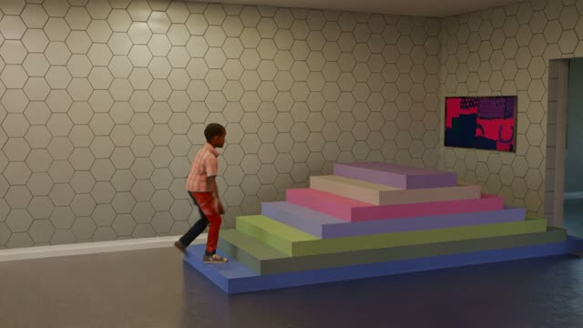
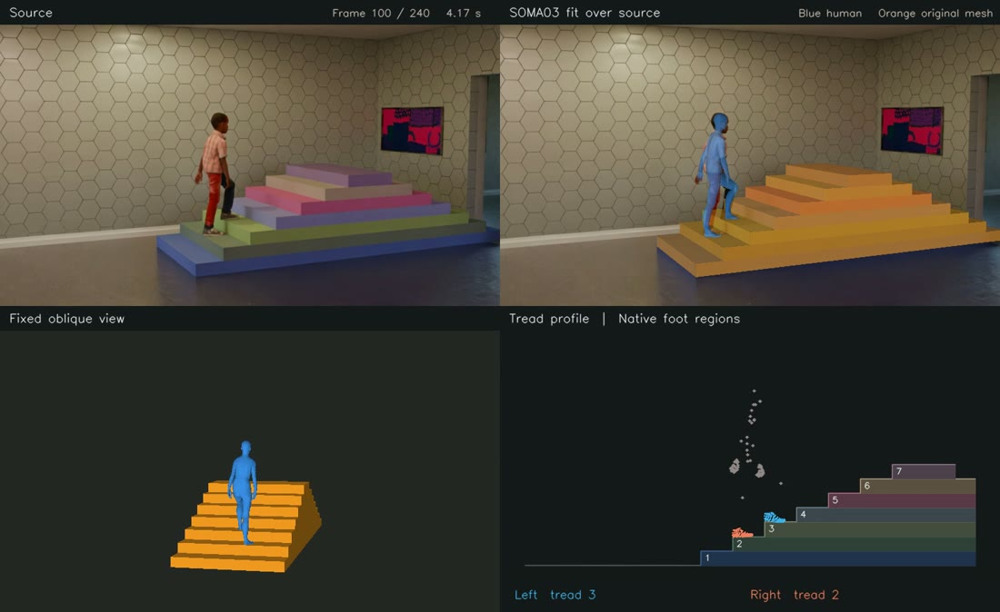
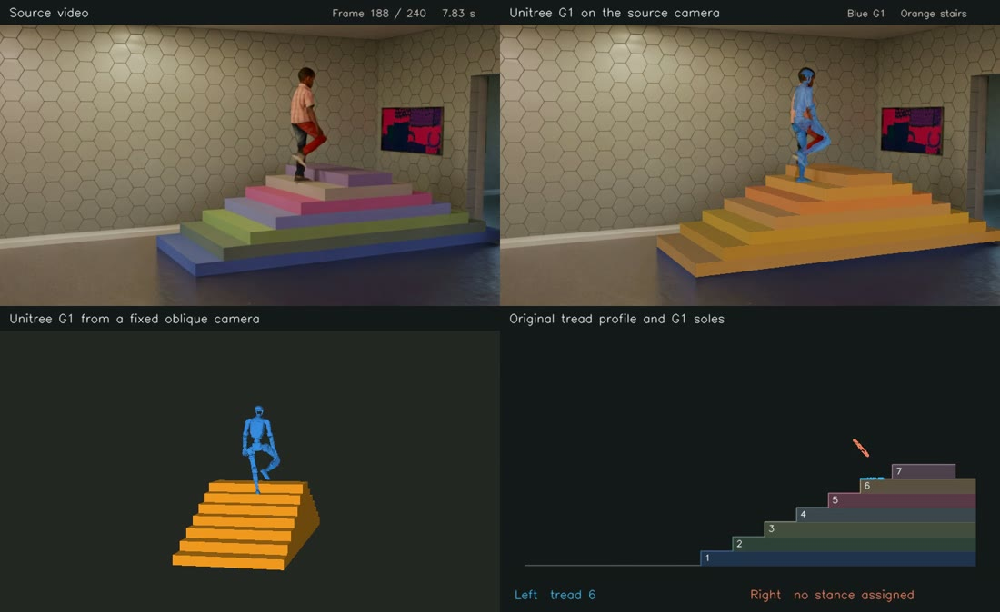
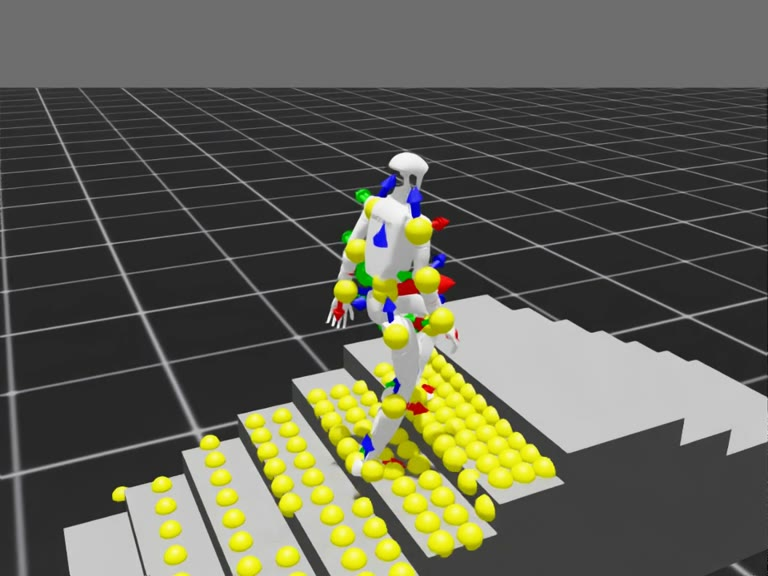

# Stair Climbing with Unitree G1

<span id="climb-stairs-with-unitree-g1"></span>

Follow a person climbing the supplied staircase. Fit the human while the stairs stay fixed, transfer the step sequence to the Unitree G1, then simulate a policy following the terrain reference.

<figure>
<video class="grail-stage-player" controls playsinline preload="none" poster="../_static/examples/stairs.jpg" aria-label="Bundled source video of the stair climb"><source src="../_static/examples/stairs-input.mp4" type="video/mp4"></video>
<figcaption>Bundled input · 241 frames at 24 fps.</figcaption>
</figure>

## Prerequisites

<span id="before-you-start"></span>

Complete [GRAIL Installation Guide](../installation.md) and [Downloads](../downloads.md). Keep the named container open. Start with `/workspace/runs/stairs` unused; the first prompt creates it. The same directory on the host is `../grail-demo/runs/stairs`. See the [glossary](../configuration.md) for terms used below.

**If an agent step stops or you reject its result**, keep the partial output and pick a fresh name such as `stairs-2`. For a clean repeat, change the run directory in **three places**: the reconstruction prompt, the retargeting prompt and the tracking block’s `CASE=` assignment. Keep the original example input path and motion key. Tell the agent which frame failed, what you saw and which scene or contact binding to correct. If only retargeting failed, leave the reviewed fit where it is. Change only the output directory in the retargeting prompt and set `CASE` to that directory in the tracking step.

With the model weights cached, budget about 12–20 minutes for a repeat fit and 9–10 minutes for G1 on the 48 GB RTX 6000 Ada. These are planning estimates from comparable runs. Review time and available GPU memory can extend them.

(stairs-fit-step)=
## 1. HOI reconstruction

<span id="reconstruct-the-human-and-object"></span>

**Host terminal, from the checkout root.** The Codex CLI reads the repository skill and runs the fitting tools in the GPU container. The camera, metric stair geometry and source timing stay bound to the fit. The cold run took 32 min 52 s on a 48 GB RTX 6000 Ada. The first depth-model download accounted for much of that time.

```bash
codex exec --approve-for-me -m gpt-6.2-sol \
  "Use the grail-agentic-hoi-recon skill in the grail-demo container. Copy
examples/g1-2dhoi/stairs/generation to /workspace/runs/stairs/generation. Run the
released reconstruction using the installed workers. Keep the original stair mesh
static and review the feet against the individual treads. Save the selected fit,
its review and a source/fit comparison reconstruction.mp4 under
/workspace/runs/stairs. Run all tools in the container using only this checkout,
its downloads and this case. Report any unresolved fit or contact."
```

(stairs-recon-result)=
### Expected result

<figure>
<video class="grail-stage-player" controls playsinline preload="none" poster="../_static/examples/stairs-recon.jpg" aria-label="Source, fitted camera overlay, fixed oblique view and sole-height profile for the whole stair climb"><source src="../_static/examples/stairs-recon.mp4" type="video/mp4"></video>
<figcaption>Full <code>reconstruction.mp4</code> from the reconstruction step, 241 frames at 24 fps. At frames 84–105, the right foot rests on tread 2 as the left foot approaches tread 3. Release image 1.2.0, RTX 6000 Ada.</figcaption>
</figure>

Open `reconstruction.mp4` and follow each stance foot in the side view through the whole climb.

**Continue to G1** if `reconstruction.mp4` plays all 241 frames, the stairs stay fixed and each stance foot lands on the tread shown in the source. If your review reports sole heights, use them to locate frames to inspect in the side view.

**Stop and review** if a stance foot lands on the wrong tread, hangs above it or drops suddenly. Inspect the same foot and frame in the source. The reference fit retained some heel overhang on tread 4.

{ref}`Run measurements and file sizes <stairs-recon-details>`.

(stairs-retarget-step)=
## 2. G1 retargeting

<span id="retarget-the-reviewed-fit-to-g1"></span>

**Same host terminal.** This converts the selected human and object motion to the 29-joint Unitree G1. Conversion and review took 8 min 43 s on the same workstation.

```bash
codex exec --approve-for-me -m gpt-6.2-sol \
  "Use the grail-agentic-retargeting skill in the grail-demo container on the
selected fit in /workspace/runs/stairs. Retarget to Unitree G1 using the terrain target. Keep
the original object mesh and scene binding. For source_python use the grail
environment and for the robot solver use imports/soma-retargeter/.venv. Save
robot.npz, retargeting.mp4 and the review under /workspace/runs/stairs. Run all
tools in the container using only this checkout, its downloads and this case.
Report any unresolved contact."
```

(stairs-robot-result)=
### Expected result

<figure>
<video class="grail-stage-player" controls playsinline preload="none" poster="../_static/examples/stairs-robot.jpg" aria-label="G1 stair climb with source, camera overlay, fixed oblique view and sole profile"><source src="../_static/examples/stairs-robot.mp4" type="video/mp4"></video>
<figcaption>Full <code>retargeting.mp4</code> from the G1 step, 241 frames at 24 fps. At frame 188 the left foot supports the robot on tread 6 while the right leg swings. Release image 1.2.0, RTX 6000 Ada.</figcaption>
</figure>

Open `robot.npz` and `retargeting.mp4`. The original clip has 241 frames and the G1 terrain target has 36 pose coordinates, including its floating base.

**Continue to a short simulation** if `robot.npz` has a `qpos` array of shape `(241, 36)`, `retargeting.mp4` plays all 241 frames and the robot lands on the intended treads in the side view. Run this shape check in the container’s `grail` environment.

```bash
python -c "import numpy as np; print(np.load('/workspace/runs/stairs/robot.npz')['qpos'].shape)"
```

**Stop** if the shape differs, a stance foot misses a tread or the motion has a sudden drop. The reference had a 12.6 mm toe intersection and was used only for exploratory simulation.

{ref}`Run measurements and file sizes <stairs-robot-details>`.

(stairs-tracking-step)=
## 3. Task-general tracking

<span id="train-and-evaluate-a-tracking-policy"></span>

**Container shell, from `/workspace/grail`.** The packer writes the stair collider and motion library under `terrain/`. The launcher starts from the released terrain policy. Use the licence settings reviewed in [Tracking weights](../downloads.md#tracking-weights). The short run below uses 64 environments and four PPO updates, saves a checkpoint, and evaluates it. This took 1 min 09 s on the RTX 6000 Ada, including simulator startup.

```bash
source /root/miniconda3/etc/profile.d/conda.sh
conda activate sonic
export PYTHONPATH="$PWD/imports/SONIC:$PWD${PYTHONPATH:+:$PYTHONPATH}"
export OMNI_KIT_ACCEPT_EULA=Yes WANDB_MODE=disabled
CASE=/workspace/runs/stairs
python -m grail.retargeting.terrain --native "$CASE/robot.npz" --motion-key stairs --output "$CASE/terrain"
NUM_ENVS=64 ITERATIONS=4 EVAL_EVERY=4 bash scripts/tracking/terrain_finetune.sh "$CASE/tracking" "$CASE/terrain"
```

(stairs-track-result)=
### Expected result

**Local short run:** 11.8% of the stair reference reached, zero completed climbs, 133.3 mm global joint error. This command produces a saved policy and metrics only. **It produces no rollout video.** See [how to render the trained stair policy](../tracking.md#stair-policy-rollout) on a supported rendering host.

<figure>
<video class="grail-stage-player" controls playsinline preload="none" poster="../_static/examples/stairs-tracking.jpg" aria-label="Following-camera recording of the final stair policy on the full reference"><source src="../_static/examples/stairs-policy-diagnostic.mp4" type="video/mp4"></video>
<figcaption>Full recording from a separate evaluation of the 5,000-update policy, 500 frames at 50 fps. The following camera moves with G1. Production image 1.1.0, one L40S. <a href="../tracking.html#stair-policy-rollout">Rollout command</a>.</figcaption>
</figure>

Open `tracking/eval/step_000004/metrics_eval.json` and read `eval/success/progress_rate`, `eval/success/success_rate` and `eval/all/mpjpe_g`, respectively. Check that `tracking/train/model_step_000004.pt` exists. A checkpoint plus an evaluation confirms the workflow ran; a progress fraction of 1 means the policy reached the end. Treat the measured values as comparisons rather than exact repeat targets.

The [full-schedule reference](../results.md#stair-climb) shows the recording from a separately rendered evaluation of the 5,000-update policy in the production image (one L40S). It reached 100% in its checkpoint evaluation. To train the full policy, reuse `terrain/` and run the [full-schedule launcher command](../tracking.md#full-training-schedule) in the same shell with a fresh output directory.

{ref}`Run measurements and file sizes <stairs-track-details>`.
