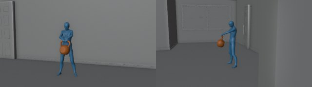

# Data Visualization

<span id="inspect-a-reconstruction-or-robot-motion"></span>

Choose the artifact that answers the question. The native geometry can show whether the human touches the handle, the kinematic G1 preview shows the commanded robot trajectory, and a [tracked rollout](tracking.md#stair-policy-rollout) shows what the simulated policy achieved.

<span id="native-soma-g1-dex3-scene-replay"></span>

## Human and object replay

<span id="replay-the-fitted-person-and-object"></span>

Use the **selected human geometry**, including animated human and object vertices, their face arrays and the calibrated source camera. Ask the reconstruction agent to deliver `selected_fit_geometry.npz` with the selected native fit, or supply the actual companion path it reported. The video or `robot.npz` alone cannot recreate these meshes. Use the same original Blender room that conditioned the clip. Both released examples used {blob}`data/Scene/indoor1.blend`; fetch the hydrated 331.4 MiB file if missing. For a different capture, use its own calibrated room and frame rate.

From the checkout root of the release container, render the kettlebell at the start, middle and end:

```bash
imports/blender/blender --background --disable-autoexec --threads 8 \
  --python-exit-code 1 --python grail/visualization/hoi_blender_scene.py -- \
  --geometry /workspace/runs/kettlebell/selected_fit_geometry.npz \
  --background-scene data/Scene/indoor1.blend \
  --output-dir /workspace/runs/guides/kettlebell-replay \
  --fps 24 --model-label SOMA03 --quality-status UNREVIEWED \
  --frames 0,60,120 --render-percent 25
```

In `nvgrail/grail:1.2.0` on an i9-14900K with no GPU passed to Docker, this took 21 seconds. Expect a roughly 335 MiB `stage2_native_replay.blend`, six PNGs and `replay_verification.json`. The file reopened with all 121 frames; maximum source projection error was 0.00052 px. Frame 0 of the video corresponds to Blender frame 1. Small projection error checks the replay, while visual inspection checks the fit. If the overlay misses the source, verify the original room and camera before adjusting geometry.



Source camera at left, oblique at right. These are two of the six stills produced by the command above.

For stairs, the same Blender command ran with `/workspace/runs/stairs/selected_fit_geometry.npz`, a fresh `/workspace/runs/guides/stairs-blend` directory and `--frames 0,120,240`. It wrote six PNGs and a 336 MiB Blender scene in 27 seconds on the same CPU. Reopening it checked 241 frames with a maximum projection error of 0.0012 px. If geometry or the original room is unavailable, the reconstruction's saved comparison MP4 can still be viewed directly.


<span id="under-the-hood"></span>

## Input layout

<span id="prepare-a-packed-robot-motion-for-replay"></span>

A terrain library pairs `robot/stairs.pkl` with `objects/stairs.pkl` and `object_usd/stairs.usd`. In the `grail` environment, convert the packed [stairs example](tutorials/stairs.md) to the renderer's trajectory format:

```bash
python -m grail.visualization.prepare_vis_shard \
  --data_dir /workspace/runs/stairs/terrain \
  --shard_dir /workspace/runs/guides/replay --quat_convention xyzw
```

<span id="output-layout"></span>
<span id="following-up-with-the-web-visualizer"></span>

On the same CPU this took under a second. Look for `trajectories/stairs.trajectory.pkl`. The accompanying `metrics_eval.json` indexes a **kinematic** replay. To judge a policy, use [tracking evaluation](tracking.md). To browse an existing MP4 without a renderer, [make a static gallery](web_visualizer.md).

## Single-motion render

<span id="render-a-packed-motion"></span>

**Isaac Sim, single motion.** With a hydrated robot USD, the repository wrapper prepares the trajectory and calls `grail.visualization.batch_render_replay`. From the checkout root in the configured container, select the robot PKL in the library you want to render:

```bash
# Pick an unused replay directory.
REPLAY=/workspace/runs/guides/stairs-isaac-replay
export GRAIL_ROBOT_USD="$PWD/imports/SONIC/gear_sonic/data/robots/g1/g1_43dof_s3.usda"
mkdir -p /workspace/runs/guides
mkdir "$REPLAY" && cp -a /workspace/runs/stairs/terrain/. "$REPLAY/" && \
  bash grail/visualization/scripts/visualize_single.sh "$REPLAY/robot/stairs.pkl" 1.5,-1.5,1.0 xyzw
```


<span id="hand-dofs"></span>
<span id="troubleshooting"></span>

On a working RTX renderer the wrapper writes `$REPLAY/vis/stairs.mp4` inside the copy. The original tutorial pack remains available for training. On the RTX 6000 Ada with driver 595.99.02, trajectory preparation passed, then Isaac exited during renderer startup after eight seconds, before writing video. If the asset check fails earlier, hydrate the robot USD. The {blob}`batch wrapper <grail/visualization/scripts/visualize.sh>` accepts a whole library. For manipulation, preserve recorded finger DOFs; older exports without them play with an open gripper.

**Unitree G1 on static terrain, software rendering.** This alternative reads the 29 joint angles and root pose from the packed robot PKL and the original fixed collider from the packed USD. In the release container at the checkout root:

```bash
source /root/miniconda3/etc/profile.d/conda.sh
conda activate sonic
export PYTHONPATH="$PWD/imports/SONIC:$PWD${PYTHONPATH:+:$PYTHONPATH}"
MODEL=imports/soma-retargeter/soma_retargeter/assets/robotics/unitree/g1/desc/mjcf/g1_29dof_rev_1_0.xml
MUJOCO_GL=egl EGL_PLATFORM=surfaceless LIBGL_ALWAYS_SOFTWARE=1 python scripts/standalone/replay_terrain.py \
  /workspace/runs/stairs/terrain stairs "$MODEL" /workspace/runs/guides/stairs-reference.mp4
```

This produced the fixed-camera clip below in 47 seconds on the i9-14900K with no GPU exposed to `nvgrail/grail:1.2.0`. It plays all 241 reference poses at 24 fps. See [the policy recording](results.md#stair-climb) to compare with simulated motion. For a moving object with articulated hand tracking, use the native retargeting preview or the Isaac renderer on a compatible host.

<video controls playsinline preload="none" poster="_static/examples/stairs-reference.jpg" aria-label="Fixed-view packed G1 stair reference, 241 frames"><source src="_static/examples/stairs-reference.mp4" type="video/mp4"></video>

## Quaternion convention

For this terrain pack, the robot's `root_rot` is **x, y, z, w**. Its object's `root_quat` is **w, x, y, z**. The native NPZ stores the free-joint quaternion **w, x, y, z**. The shard converter's option selects the library's **robot** convention. A rotated or flipped character is a reason to check that field before changing the camera. [Outputs and coordinates](outputs.md) gives the measurements for both examples.

## Batch render

<span id="render-a-whole-motion-library"></span>

On a host with a working Isaac renderer, select a writable motion library with matching `robot/<key>.pkl`, `objects/<key>.pkl` and `object_usd/<key>.usd`. An optional `meta/<key>.pkl` can supply the table pose. In the SONIC environment at the checkout root:

```bash
bash grail/visualization/scripts/visualize.sh "$LIB" 16 1.5,-1.5,1.0 xyzw
```

The arguments are the library, maximum motions, camera offset and robot quaternion order. The default is 16 motions. Use 0 for all motions without the concatenated video or grid. Output lives in `vis/`, apart from the original input videos. With post-processing enabled, look for `all_motions_combined.mp4` and `examples_grid.mp4` as well as the individual clips. The single-motion wrapper accepts a robot PKL, camera offset and quaternion convention.

For a release or successful-rollout export the usual robot order is `xyzw`. Choose `wxyz` for a library known to use scalar-first robot rotations. The optional `auto` heuristic compares components and can choose incorrectly on a tilted robot. Inspect the converter’s convention counts. Recorded `hand_dof_pos` has 14 channels. If absent, the renderer fills the missing joints with zeros. A visible open hand can therefore indicate missing hand data.

The wrapper prepares a shard of trajectories, reorders body joints for Isaac, renders them in one simulator session and optionally labels/combines the videos with FFmpeg. To inspect or reuse the intermediate shard:

```bash
python -m grail.visualization.prepare_vis_shard --data_dir "$LIB" --shard_dir "$SHARD" \
  --max_motions 16 --quat_convention xyzw
python -m grail.visualization.batch_render_replay --shard_dir "$SHARD" --traj_dir "$SHARD/trajectories" \
  --object_usd_dir "$LIB/object_usd" --output_dir "$LIB/vis" \
  --camera_offset 1.5 -1.5 1.0 --camera_target 0.0 0.0 0.8 --skip_existing --headless
```

Choose a fresh writable `SHARD`. If a video lacks the object, check the USD stem and texture paths. If the robot is flipped, verify quaternion order before tuning the camera. Supply the hydrated robot USD when required. The Isaac wrapper and preparation commands were checked; see the rendering limitation and software alternative above.
