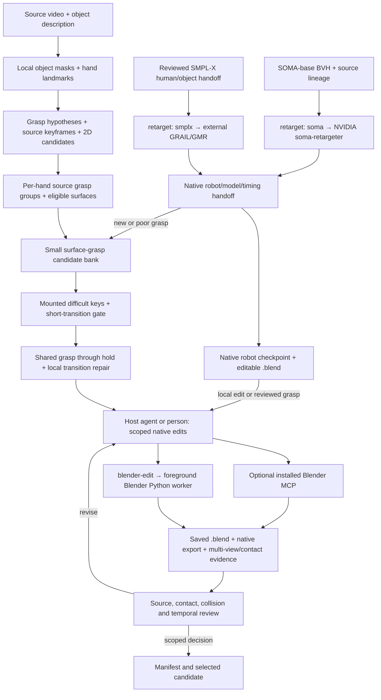

# Runtime architecture

Implementation lives directly under `src/`. The installed Python package name
remains `agentic_retargeter`, mapped by setuptools; this does not introduce a
nested implementation directory. `tools/` contains checkout launchers and setup
guides. It does not duplicate solver or perception implementations.

## Boundaries

| Module | Responsibility |
| --- | --- |
| `video_perception.py` | Optional local detector/segmenter/hand-landmarker adapters, tracked image observations, source PTS and model bindings |
| `video_grasps.py` | Temporal hypotheses, conservative missing-evidence handling, source keyframe and contact-candidate exports |
| `gmr.py` | Validated external process configuration, source/human-model hashes, fresh conversion outputs |
| `soma.py` | Bound SOMA-base BVH conversion through the official external runtime, native CSV contract |
| `soma_contacts.py`, `soma_contact_runtime.py` | Optional fixed material point/normal objectives inside the same SOMA IK solve; source phase binding and post-clamp measurements |
| `soma_collision.py`, `soma_collision_runtime.py` | Explicit original-mesh scope and GPU/CPU sampled clearance penalties inside contact-aware initialization; independent mesh audit remains required |
| `retarget.py` | Explicit SMPL-X/GMR and SOMA/soma-retargeter routing without cross-model fallback |
| `graspgen.py`, `graspgen_inputs.py` | On-demand native G1 hand/object preparation and unselected grasp-frame proposals |
| `graspgen_runtime.py`, `graspgen_worker.py` | Pinned external local GraspGenX process; optional CUDA/model dependencies stay outside ordinary editing |
| `graspgen_preview.py` | Offline free-wrist proposal preview; no IK, contact or motion acceptance |
| `retarget_native.py` | Strict units, root pose, joint order, original robot-model and optional HOI sidecar handoff |
| `blender_edit.py` | Local round configuration, explicit operations, checkpoint lineage and resulting evidence |
| `blender_runtime.py` | Provider-free process transport, bindings and observation records |
| `blender_worker.py` | Native edits, scoped constraints, cameras/dashboard, export and saved-scene round trip |
| `contact_edit/` | Shared native pose fitting and editable animation curves |
| `motion_audit.py`, `repair_geometry.py` | Bound, incremental original-triangle/contact audits with explicit pair and sample coverage |
| `repair_scope.py` | Topology-only pair inventory, omitted geometry and editable ancestry; no collision or motion acceptance |
| `repair_numba.py` | Optional compiled CPU BVH candidate traversal; original float64 triangle audit remains shared |
| `local_repair.py` | Coupled short-window repair with fixed contact targets, protected poses and audit-derived clearance witnesses |
| `repair_iteration.py` | Separate smooth working seed with immutable original bounds/prior; native hinge and actual wrist derivative guards across joins |
| `repair_material.py`, `repair_tensor.py` | Optional portable Torch/Warp proposals with fixed material contacts and native FK; independent audit retains acceptance |
| `repair_gpu.py` | Optional original-mesh GPU queries and conservative broadphase; float64 triangle checks remain authoritative |
| `repair_newton.py`, `repair_reference.py` | Pinned research adapters for Newton IK and HOI/MR-inspired experiments; excluded from the Blender bundle |
| `repair_bridge.py`, `repair_worker.py` | Current-curve snapshots, stale-result guards and external add-on repair/re-audit jobs |
| `inspection.py`, `blender_inspection.py` | Numerical contact inspection and Blender diagnostic geometry |
| `robot.py`, `native.py`, `contact.py` | Existing native backend and bounded candidate tools |
| `manifest.py`, `media.py` | Provenance, review selection and portable comparison pages |
| `extensions/blender/` | UI panels and a reproducible ZIP bundling required implementation files |

The shared worker transport lives in `blender_runtime.py`; ordinary editing makes
no remote model calls. An installed MCP connection is
optional; this repository does not implement or require an MCP client.

## Evidence flow

1. Video perception binds the original file, timestamps and actual local model
   assets. Missing detections and ambiguous identities remain visible.
2. Planning binds those observations and masks. Its 2D contact hypotheses are
   reviewed against the source before defining mounted native robot contacts.
3. Initial conversion routes by source model: SMPL-X through GMR, SOMA-base BVH
   through NVIDIA soma-retargeter. External dependencies and original assets stay
   in their configured installations. SOMA supports the bundled body-only G1 and
   an explicit G1 + Dex3 registry with native hand-frame calibration. Native
   handoff records the actual model and separately bound object trajectory. See [contracts and commands](../tools/retarget/README.md).
4. For a new or poor grasp, compare a finite surface-grasp bank before fixing
   material contacts. Screen original geometry, mount survivors through native
   arm FK, and check difficult keys/short transitions. Confirmed rigid holds
   share an object-relative hand pose and contact layout through interpolation;
   uncertain support and sliding stay explicit. Normal alignment is disabled.
5. Protect reviewed holds while repairing approach/closure and joins. Authorized
   object edits share one path across both hands, with bounds from the original
   trajectory and explicit temporal limits. `surface_grasp.py` batches declared
   region proposals; `shared_grasp.py` mounts/propagates them with explicit native
   joint and optional object bounds. `grasp_io.py` binds their original inputs.
   These [public commands](../tools/grasp/README.md) produce unreviewed candidates;
   full geometry, approach/closure and source review remain separate stages.
6. Blender edits operate on a selected native scene, named joints and permitted
   windows. Each round saves a new `.blend`, native export and review evidence.
7. Source images, proposed 3D contacts and native measured proximity are distinct
   evidence channels. The dashboard does not relabel 2D detections as actual
   contact. Selection still requires a scoped review record.

For local transition failures, use the [shared audit/repair entry point](../tools/repair/README.md)
before adding a case-specific optimizer. It preserves original inputs and emits
an unselected native candidate. The audit and solver share bound geometry and
reuse unchanged sampled states. Their finite geometric checks remain distinct
from Blender/source review and from Newton collision diagnostics.

For new or poorly initialized grasps, the [optional GraspGenX tool](../tools/graspgen/README.md)
can propose alternative grasp frames from the original object and native hand
geometry. Only `graspgenx run` invokes the external local model; conversion,
sequence loading and repair remain independent. Its proposals require mounted
native fitting and the existing source/contact/geometry/temporal review before
selection. It does not replace the contact targets of a selected trajectory.

Legacy `scripts/standalone/contact_edit_kit` Python entry points forward to
`src/contact_edit`.
