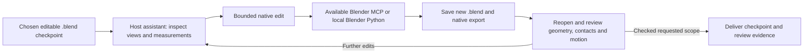

# Local Blender editing and iteration

The host assistant plans edits, inspects rendered evidence, and chooses the next bounded change. `blender-edit` executes one inspect/edit round in a foreground Blender Python process without calling a model API. No remote model API is called, even if credentials are present.

Use an installed Blender MCP connection when useful for interactive editing, or use `blender -b --python` for local scripted work. This repository supplies the Python-process worker; it does not bundle a live MCP client or take over an arbitrary open Blender window. Both routes use native joint controls and preserve a `.blend` file as the editable state.



Keep original scenes and previous iterations. Each round starts from the latest chosen `.blend`, preserves accumulated native curves and scene bindings, and writes a new checkpoint beside its native candidate and evidence. The Blender file is the editable state; rendered images and NPZ exports are review/output artifacts, not substitutes for it. Blender's file extension is `.blend`.

## Prepare the scene and scope

Use a Blender 4.2/4.3 checkpoint already containing the contact kit's `ContactEdit_Curves`, frozen reference and embedded native/model/plan **data**. Blender 4.3.2 is tested. Install this repository in editable mode with `pip install -e .`; the worker uses kit scripts from this checkout. No inference package is required.

Rendered observations require a native visual binding:

- The compiled model contains its original joint metadata plus `body_names`, `body_parentid`, `body_pos`, `body_quat`, `body_jntadr`, `body_jntnum`, `jnt_pos`, `jnt_axis` and `qpos0`.
- Each non-world model body has one explicitly named Blender transform object. Put mesh-local offsets/scales in children; body transforms must have unit world scale. The current FK implementation supports at most one joint per body and direct world coordinates. Unsupported rigs fail explicitly.
- The original object has a separate named object; source object transforms/scales come from the frozen native motion. At least two existing cameras are named explicitly.

The worker does not evaluate embedded scene Python. A controls-only or arbitrary rig is not automatically a native visual preview. Preparing a new case's matching model/body mapping remains a separate input step.

Example configuration (source frame 0 corresponds to Blender frame 1):

```json
{
  "schema_version": 1,
  "input_blend": "input/editable_curves.blend",
  "blender": "/path/to/blender-4.3.2",
  "goal": "Slow closure in the declared window, preserving the reviewed grasp at frame 20.",
  "source_images": ["source/frame10.png"],
  "spec": {
    "editable_joints": {
      "pad_hinge": {
        "window": [0, 20],
        "limits_rad": [-0.6, 0.6],
        "max_delta_rad": 0.55
      }
    },
    "observation_frames": [6, 10, 20],
    "cameras": ["SourceCamera", "SideCamera"],
    "substeps": 4,
    "render": {"resolution": [512, 512], "engine": "CYCLES", "samples": 16},
    "preview": {
      "mode": "native_fk",
      "model_text": "ContactEdit_Model.npz.b64",
      "body_objects": {"base": "NativeBody_base", "moving_pad": "NativeBody_moving_pad"},
      "object": "OriginalObject"
    }
  },
  "worker_timeout": 180
}
```

Replace example joints, limits, cameras and the complete body map with the actual case. Scope bounds may narrow the native plan and original model limits; they cannot enlarge them. `max_delta_rad`, when supplied, bounds change relative to the embedded original native sequence, including accumulated edits. Extra protected keys are read from the original plan. Select observation frames covering the requested edit, transitions and relevant later contacts; one frame cannot establish an animation's quality.

Native body and object bindings must have a single transform owner. The worker rejects baked transform Actions on either binding because Blender can reevaluate them during rendering and override native FK or object interpolation. Older imported scenes with these Actions require an explicit, versioned ownership rebase: preserve the original scene and Actions, retain frozen native object samples, and verify native preview after rendering and reopening. The worker does not detach user Actions automatically. Non-transform Action channels such as visibility remain supported.

`goal` records the intent; the local command does not interpret it or generate edits. `source_images` are preserved as bound review inputs. Legacy `max_completion_tokens` and `request_timeout` fields are ignored for configuration compatibility and are excluded from the effective local configuration.

## Inspect, edit and continue

Omit `--operations` to inspect the scene without changing its keys:

```bash
python -m agentic_retargeter blender-edit \
  --config case.json --output runs/inspect_001
```

Write a JSON list of explicit native operations for an edit round, for example `edit_001.json`:

```json
[
  {"op": "set_joint_key", "joint": "pad_hinge", "source_frame": 10, "value_rad": 0.15}
]
```

Use `delete_joint_key` with `joint` and `source_frame` to remove an existing editable key. Protected endpoints/milestones, frozen coordinates and scope limits remain enforced. Operations affect native curves, not display mesh deformation.

```bash
python -m agentic_retargeter blender-edit \
  --config case.json --operations edit_001.json --output runs/edit_001

# Review the round, then keep its accumulated edits in the next round.
python -m agentic_retargeter blender-edit \
  --config case.json \
  --input-blend runs/edit_001/candidate/native/editable_curves.blend \
  --operations edit_002.json --output runs/edit_002
```

Each invocation requires a new output directory. There is no model session or `--resume`; `--input-blend` selects the parent editable checkpoint. An inspect-only round also saves a checked scene/export. Open the resulting `.blend` for manual editing when needed, use **Save As** to write those changes to a new path, then bind that saved file in the next local round. Editing a recorded checkpoint in place causes a hash mismatch and is refused.

The output includes:

- `candidate/native/editable_curves.blend`: the new editable checkpoint.
- `candidate/native/candidate_UNREVIEWED.npz`: exported native motion.
- `candidate/`: before/after camera images, inspection evidence and export checks.
- `iteration.json`: parent checkpoint, effective configuration, operations, runtime and evidence hashes.

An unchanged previous local checkpoint links to its parent iteration automatically. `EXPORTED` records a successful tool round; motion status remains `UNREVIEWED`, `selected` remains false and `api_calls` is zero. Failed or interrupted rounds retain their evidence and require a new output path for the next attempt.

The command creates an isolated Blender profile, runs in the foreground, and preserves the input scene. Direct scripted work can use the same execution pattern:

```bash
/path/to/blender-4.3.2 -b --disable-autoexec /absolute/case/round_001.blend \
  --python-exit-code 1 --python /absolute/case/edit_round.py
```

Such a script must save a new `.blend`, export through the guarded native tools and verify the saved/native round trip. For installation or preference tests, create the isolated `BLENDER_USER_CONFIG`, `BLENDER_USER_SCRIPTS` and `BLENDER_USER_EXTENSIONS` directories before launching Blender and verify they are used; see the [extension test guide](../extensions/blender/README.md#isolated-installation).

## Dashboard and optional MCP

For repeated sequence previews, use the [cached parallel render tool](../tools/render/README.md).
It renders exported native samples against a fixed scene template, records the
actual graphics backend, and reuses only frame/view images with identical bound
inputs. Use short drafts during iteration and a full-duration final preview;
keep motion checks and editable-scene round-trip validation unchanged.

The [hand/contact dashboard](hand-inspection.md) remains inside Blender. Add its configuration as `spec.inspection`, set `spec.inspection_layout` to `"dashboard"`, and omit `inspection_layers` to render one combined dashboard per before/after frame alongside the mounted robot views. The default `"views"` layout retains individual inspection cameras. Missing predictions remain explicitly unavailable. These observations require no model call.

For interactive work, a host with an installed Blender MCP connection may invoke the add-on's native operators through that connection, inspect the dashboard and save a new `.blend`. See [operator examples](../extensions/blender/README.md#automation--blender-mcp). Preserve the same edit scope and use the guarded native export, then verify the saved scene against exported motion. Report the transport actually used. If MCP is unavailable, local foreground Blender Python provides the supported fallback without blocking iteration.

## What the checks establish

The worker checks original-scene preservation, native frozen coordinates/object fields, source timing, protected keys, declared native joint limits at sampled subframes, export equality and saved Blender reopening. Cycles renders use CPU and two threads by default.

Every candidate remains **UNREVIEWED** and **unselected**. A successful local round does not establish original-mesh clearance, fixed material contact gaps/normals, source/depth agreement, whole-sequence timing or physical validity. The worker reports missing motion checks. Preserve those requirements from the retargeting skill for acceptance. Blender Bézier subframes and downstream interpolation of native frame-rate samples are different; the export report compares them at sampled times, not continuously.

The worker does not call a model or certify a real grasp.
